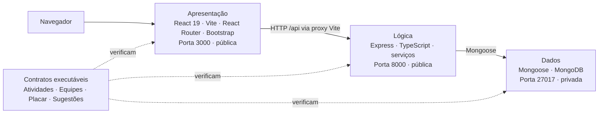

# Arquitetura do OctoFit Tracker

O OctoFit Tracker é uma aplicação de três camadas para um programa de atividades físicas escolar. O código inicial inclui contratos de API e pontos de implementação intencionalmente incompletos para que você use o modo agent do GitHub Copilot em um ciclo guiado por testes.

## Limites entre as camadas

- **Camada de apresentação**: React 19, Vite, React Router, Bootstrap e o cliente HTTP compartilhado em `octofit-tracker/frontend/src`. Componentes de rota exibem os dados e os estados de carregamento, vazio e erro; não acessam MongoDB nem implementam regras de negócio.
- **Camada de lógica**: rotas Express recebem e formatam requisições/respostas; os serviços TypeScript em `octofit-tracker/backend/src/services` validam entradas e aplicam as regras de atividades, equipes, placar e sugestões. Essa camada expõe `/api/*` na porta `8000` e usa os modelos, sem transferir regras para a interface.
- **Camada de dados**: modelos Mongoose em `octofit-tracker/backend/src/models` definem documentos, campos, validações e referências. `src/scripts/seed.ts` popula dados de demonstração por esses modelos, de forma repetível e sem apagar dados não relacionados; MongoDB escuta na porta `27017`.
- **Fluxo permitido**: navegador → interface → HTTP `/api` → rota → serviço → modelo Mongoose → MongoDB. Respostas percorrem o caminho inverso; cada camada mantém sua responsabilidade e não contorna a camada seguinte.

## Portas e regras de ambiente

- MongoDB: `27017` (privada)
- API Express: `8000` (pública)
- Interface Vite: `3000` (pública)
- O navegador acessa caminhos relativos `/api`. O Vite os encaminha para `http://localhost:8000`; `VITE_API_BASE_URL` pode substituir a URL-base.
- Não encaminhe nem torne públicas outras portas.

## Contrato da API

| Capacidade | Método e caminho | Comportamento esperado |
| --- | --- | --- |
| Registro de atividades | `GET /api/activities`, `POST /api/activities` | Lista e cria atividades válidas. POST recebe `userId`, `teamId`, `type` e `minutes`; `userId` e `teamId` devem ser IDs bem-formados de uma pessoa e uma equipe existentes, caso contrário a API retorna um 4xx intencional (nunca um 500 causado por erro de conversão). Uma atividade criada armazena `user`, `team`, `type` e `minutes` enviados, além de `points` e `occurredAt` calculados. |
| Equipes | `GET /api/teams`, `POST /api/teams` | Lista e cria equipes com integrantes. As equipes criadas e listadas mantêm os valores enviados em `name` e `mascot`. Rejeita uma equipe sem nome com `400`. |
| Placar | `GET /api/leaderboard` | Retorna as equipes ordenadas pela soma dos pontos de suas atividades, da maior para a menor. Cada item contém `teamName`, `totalPoints` e uma `rank` iniciada em 1. |
| Sugestões de treino | `GET /api/workouts/suggestions/:userEmail` | Recomenda treinos com base nos padrões de atividade recentes da pessoa correspondente ao e-mail seed. O foco da primeira sugestão (`focus`) corresponde à meta ou à atividade recente dessa pessoa, e o campo `reason` explica o motivo. Um e-mail sem pessoa correspondente retorna um 4xx intencional (por exemplo, `404`). |

## Decisões de implementação

- **Apresentação**: manter o cliente HTTP compartilhado e componentes de rota existentes; cada tela consome apenas seu endpoint e apresenta estados acessíveis de carregamento, vazio e erro junto aos dados retornados. Não duplicar regras da API na interface.
- **Lógica**: manter as rotas como adaptadores HTTP finos e concentrar validação e regras no `octofitService.ts`. Entradas inválidas ou referências inexistentes devem produzir respostas 4xx controladas, nunca erros 500 de conversão ou respostas 501 de funcionalidade pendente.
- **Dados**: completar validações e valores padrão nos modelos Mongoose sem mudar a estrutura do seed que já passou no teste de idempotência. Seed e operações da aplicação continuam sendo os únicos caminhos para estruturar e popular o banco.
- **Atividades**: validar formato e existência de pessoa/equipe antes de persistir; guardar as referências, tipo e minutos recebidos e calcular pontos e data no serviço. Listagem e criação devem serializar referências como IDs no contrato HTTP.
- **Equipes**: validar o nome, preservar nome e mascote recebidos e manter os integrantes informados como referências de usuários; listagem e criação devem retornar esses integrantes de forma estável.
- **Placar**: agregar os pontos das atividades por equipe, ordenar do maior total para o menor e atribuir posições começando em 1 após a ordenação.
- **Sugestões de treino**: localizar a pessoa pelo e-mail, usar a meta e as atividades recentes para ordenar sugestões compatíveis e explicar a escolha em `reason`; e-mail desconhecido recebe resposta 4xx.

## Baseline dos testes

Execução observada em 2026-11-19, antes de implementar os contratos:

| Suíte | Resultado | Falhas observadas |
| --- | --- | --- |
| `npm run test:data --prefix octofit-tracker/backend` | 4 falhas, 1 sucesso em 5 testes | Os quatro testes de validação de `User`, `Team`, `Activity` e `Workout` falham porque os campos obrigatórios não geram erros de validação. O teste de seed representativo e idempotente passa. |
| `npm run test:api --prefix octofit-tracker/backend` | 4 falhas em 4 testes | As criações de atividade/equipe recebem 501 em vez de 4xx para entradas inválidas; o placar retorna lista vazia; a sugestão de treino não fornece `reason` esperado. |
| `npm test --prefix octofit-tracker/frontend` | 15 falhas em 15 testes | As quatro telas ainda mostram “Implementação pendente”; por isso não consomem a API nem exibem conteúdo, carregamento, estado vazio ou alerta de erro. |

## Plano de testes e ordem segura

Implementar de baixo para cima e liberar a camada seguinte somente após o contrato anterior passar:

1. **Dados**: completar schemas e validações Mongoose; executar `npm run test:data --prefix octofit-tracker/backend`. Critério: validações exigidas passam e o seed continua idempotente, preservando registros não relacionados.
2. **Lógica e API**: implementar no serviço criação/listagem de equipes e atividades, depois placar e sugestões; executar `npm run test:api --prefix octofit-tracker/backend`. Critério: os quatro contratos passam, incluindo rejeições 4xx e serialização esperada.
3. **Apresentação**: ligar cada componente de rota ao cliente compartilhado e implementar dados e estados acessíveis; executar `npm test --prefix octofit-tracker/frontend`. Critério: os 15 testes passam nas quatro rotas.
4. **Regressão e compilação**: executar novamente as três suítes acima e então `npm run build --prefix octofit-tracker/backend` e `npm run build --prefix octofit-tracker/frontend`. Critério: todos os testes e as duas compilações passam antes de considerar a implementação concluída.

## Plano de testes

Registre os comandos executados e o significado de cada falha.

- Testes da camada de dados: `npm run test:data --prefix octofit-tracker/backend`
- Testes da API: `npm run test:api --prefix octofit-tracker/backend`
- Testes do frontend: `npm test --prefix octofit-tracker/frontend`
- Compilação do backend: `npm run build --prefix octofit-tracker/backend`
- Compilação do frontend: `npm run build --prefix octofit-tracker/frontend`
